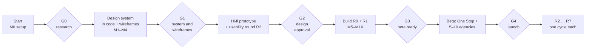

# Build plan

How Agency OS goes from this pack to a launched product, mostly built by Claude Code, with the founder approving at five gates. Read with `../../CLAUDE.md` (the rules) and `progress.md` (where we are).

## The path

Research (G0) runs alongside M0 to M3: setting up the repo and the design system in code does not depend on its results. Nothing after G1 starts without the founder's approval of the gate before it.

## Gates

| Gate | The founder checks | Pass lines | Material Claude prepares |
| --- | --- | --- | --- |
| **G0 Research** | Interview and survey readout; assumptions A1 to A6 answered; roadmap changes | `../01-research/assumptions.md` pass lines; or the founder waives G0 in writing (recorded in `decisions.md`) | Synthesis template filled from the founder's notes; proposed PRD and roadmap edits |
| **G1 System and wireframes** | Design system in code (Storybook) matches the approved reference; wireframes of every MVP screen; tree test result | Tree test first-click success ≥ 80% on primary labels; every component has all states; contrast check green | Storybook link, `/prototype` link, screenshot set, list of differences from the reference |
| **G2 Design approval** | Hi-fi prototype of every MVP screen (S01 to S42 in R0/R1 scope), light and dark, phone and desktop; usability round R2 | ≥ 80% task success on T1 to T10; no blocker issues; SEQ ≥ 5.5 | Prototype link, test script, findings and fixes |
| **G3 Beta ready** | R0 + R1 built; One Stop has run real work on it for 2 weeks; CA has reviewed invoices; legal documents ready; security review done | All PRD acceptance criteria; CI green; performance budgets met; no open critical or high findings | Release notes, checklist results, known issues |
| **G4 Launch** | Beta results: activation, retention, SUS, support load | Activation ≥ 60% of beta workspaces within 7 days; SUS ≥ 75; no data or money incident | Beta report, launch checklist, pricing page |

The founder approves by replying "Approve G1" (and so on) in the session, or on the pull request. Claude records the approval and date in `decisions.md`.

## Milestones (R0 and R1)

Each milestone is one or a few pull requests. Size: one to three Claude Code sessions each. The PRD epics are in `../02-product/prd-mvp.md`.

| # | Milestone | Contents | Done when |
| --- | --- | --- | --- |
| M0 | Repo setup | Monorepo (pnpm, Turborepo), `apps/web` (Next.js App Router, TypeScript), packages skeleton, ESLint, Prettier, Vitest, Playwright, Storybook, GitHub Actions CI, `.env.example`, README per package | `pnpm check` and CI green on an empty app; preview deploy works (after the founder connects Vercel) |
| M1 | Tokens and theme | `packages/tokens` from `tokens/` (generator + contrast check), `globals.css` in the app, Geist via the `geist` package, Phosphor, light/dark switch (`data-theme`) | Token pages in Storybook; contrast check in CI |
| M2 | Core components | shadcn components installed and restyled to match `design/`: Button, IconButton, Input, Textarea, Select, Checkbox, Switch, Badge, Avatar, Tabs, Segmented, Card, Alert, Toast, Dialog, Sheet, Tooltip, Dropdown, Popover, Skeleton, Progress, EmptyState | Every state in Storybook; visual check against `design/screens/` and `design/showcase.html`; axe clean |
| M3 | Patterns | Sidebar, Topbar, CommandPalette, DataTable, PipelineBoard, RecordHeader, ActivityFeed, MetricCard, PhaseStepper, GateCard, InvoiceSummary, Checklist, portal shell | Same as M2; the three reference screens rebuilt from these parts match the design |
| M4 | Wireframes → **G1**, then hi-fi prototype → **G2** | `/prototype` routes for every R0/R1 screen with example data, light and dark, phone and desktop; test script for R2 | Gate approvals |
| M5 | Accounts and workspaces (E0.1, E0.2) | Schema, RLS functions and policies, auth (Google, magic link; phone OTP behind a flag), workspace setup, invitations, roles, switcher | RLS tests; e2e 1 and 10 |
| M6 | App shell and platform (E0.3, E0.5) | Navigation per role, command palette with search, notifications, settings, audit log, data export, plans and limits, Razorpay subscriptions (test mode) | e2e 11, 12 |
| M7 | Onboarding (E0.4) | Checklist, sample data load and removal | e2e 2 |
| M8 | Leads (E1.1) | Board and table, stages, activity, follow-ups, lost reasons, CSV import and export, enquiry form | e2e 3 |
| M9 | Clients and conversion (E1.3, E1.4) | Client records, contacts, lead to client, portal invite | e2e 5 (first half) |
| M10 | Quotes and proposals (E1.2) | Quote builder (GST via `core/tax`), proposal blocks and templates, public view, accept and sign, PDFs | e2e 4 |
| M11 | Projects, phases and gates (E1.6) | Templates (seven phases), project setup, gate requests and decisions | e2e 5, 6 |
| M12 | Tasks and team (E1.7, E1.10) | Board, list, calendar, my tasks, daily updates | e2e 13 |
| M13 | Invoices and payments (E1.8) | Invoice types, numbering, PDFs, payment links, webhooks, manual payments, reminders | e2e 7, 8, 9; tax unit tests 100% |
| M14 | Client portal (E1.5) | Home, project, approvals, invoices and pay, messages, branding | e2e 6 (portal half); portal performance budget |
| M15 | Dashboard and Today (E1.9) | Metrics, at-risk projects, team load, Today | Numbers match test data; each links to its list |
| M16 | Hardening → **G3** | Emails and notification settings, performance, accessibility pass, security review, CA and legal items, production setup, dogfooding by One Stop | G3 pass lines |

Built-in content (phase template, pipeline defaults, proposal template, invoice defaults, onboarding, empty states, notifications, plan limits) comes from `../02-product/defaults-and-content.md`; the tax and money unit tests start from `../04-engineering/tax-test-cases.md`.

After G4, each release (R2 to R7 in `../02-product/roadmap.md`) runs the same loop at a smaller scale: short spec → wireframes → founder check → build → test → release.

## How Claude works on its own

**Start of every session**
1. Read `CLAUDE.md`, then `progress.md`, then the docs for the current milestone.
2. Check `open-questions.md` for answers the founder has added.
3. Pull the latest `main`; create the milestone branch.

**During the session**
- Work in small, tested steps; commit often with Conventional Commits.
- Follow the design system and rulebook exactly; when unsure, choose the option the docs describe and note it.
- Keep the app runnable at every commit.

**End of every session**
- Update `progress.md` (done, in progress, next, blockers) and `decisions.md` if anything was decided.
- Push the branch; open or update the pull request with screenshots and test evidence.
- If CI is green and the milestone is not a gate, merge (if the founder has allowed it; see open question 13), else leave it for review.

## When to ask the founder

**Ask (and keep working on something else meanwhile)** when a decision:
- spends money or needs an account, key, KYC or legal sign-off;
- changes pricing, plans, the brand, the product name or the domain;
- changes scope, the roadmap order or a gate;
- affects clients' money or legal documents (tax wording, signing, terms);
- conflicts between two docs in this pack.

**Don't ask; decide, record in `decisions.md`, and mention it in the PR** when the choice is reversible and the docs point to a sensible default (a library version, a component detail, a test approach, file layout).

**How to ask:** batch questions in one message, number them, give a recommended answer and what happens if there is no reply. Add each to `open-questions.md` with the default.

**Never:** invent research results, testimonials, metrics or customer names; ship without tests; commit secrets; use colours, fonts or icons outside the design system; describe a feature as coming from another product; skip a gate; deploy to production before G3.

## Risks and how the plan handles them

| Risk | Mitigation |
| --- | --- |
| Building before research confirms demand | Gate G0 before hi-fi; research runs during M0 to M3 |
| GST mistakes | Pure, fully tested tax module; CA review blocks G3 |
| Data leaking between agencies | RLS on every table, cross-tenant tests in CI |
| Scope creep in R1 | PRD out-of-scope list; new ideas go to the roadmap, not the milestone |
| A generic-looking UI | Approved design system; visual checks against `design/` at every UI milestone |
| Long autonomous runs drifting | `progress.md` each session; gates; small PRs |
