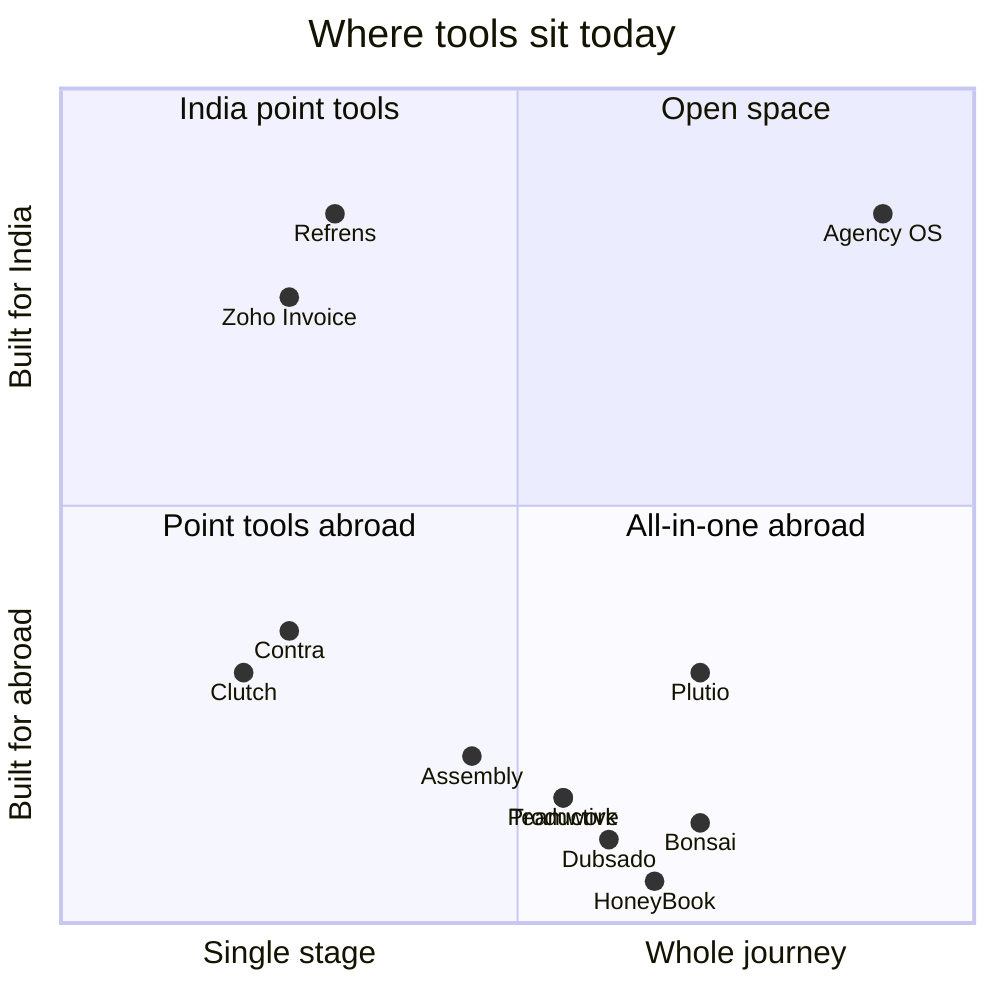

# Competitive analysis

Based on public pages reviewed on 25 October 2026 (see `desk-research.md` for sources). "Seen" means the vendor's page shows it; "not seen" means we didn't find it on the pages reviewed. It does not mean the product lacks it. Re-check with free trials during the design phase.

## Coverage of the Agency OS journey

| Stage | HoneyBook | Dubsado | Bonsai | Plutio | Productive / Teamwork | Assembly | Refrens / Zoho Invoice | Clutch / Contra | **Agency OS (plan)** |
| --- | --- | --- | --- | --- | --- | --- | --- | --- | --- |
| 1 Get found (profile, marketplace) | Not seen | Not seen | Not seen | Not seen | Not seen | No (not for directories) | Not seen | **Seen** | Profile with process and toolkit, marketplace, free tools |
| 2 Capture leads | Seen | Seen | Seen | Seen | Partly (CRM) | Seen (CRM) | Not described | Briefs and quotes | Pipeline, sources, form embed, lead sync |
| 3 Win the work (quote, proposal, sign) | Seen | Seen | Seen | Seen | Partly (quotes) | Seen | Quotations | Not seen | Quote, proposal, e-sign, AI draft |
| 4 Onboard (portal, intake, advance) | Seen | Seen | Seen | Seen | Partly (intake) | **Seen** | Portal for invoices | Not seen | Portal, intake, uploads, advance |
| 5 Plan (phases, PRD) | Not seen | Not seen | Partly (Gantt) | Partly | Seen (planning) | Not seen | Not seen | Not seen | Phase templates from the Playbook, PRD, gates |
| 6 Build and delegate | Tasks | Not seen | Seen | Seen | **Seen** (resourcing, time) | Project tracking app | Not seen | Not seen | 6 views, time, attendance, payouts |
| 7 Review and talk (approvals, changes) | Not seen | Partly | Not seen | Seen (comments) | Seen (proofs) | Seen (approval flows) | Not seen | Messaging | Gate approvals, change requests, status reports |
| 8 Get paid | Seen | Seen | Seen | Seen | Seen | Seen | **Seen (GST)** | Not seen | GST, export and multi-currency invoices, UPI links |
| 9 Hand off | Not seen | Not seen | Not seen | Not seen | Not seen | Not seen | Not seen | Not seen | **Handoff package and acceptance** |
| 10 Grow (reviews, referrals, retainers) | Not seen | Not seen | Retainers | Not seen | Retainer budgets | Not seen | Client reviews (Zoho) | Reviews | Verified reviews from portals, referrals, retainers |
| Playbook (process, prompts, tools reused) | Not seen | Not seen | Not seen | Not seen | Docs | Not seen | Not seen | Not seen | **Core of the product** |
| India money (GST, LUT, UPI) | Not served in India | Not seen | Not seen | "Local taxes" | Not seen | Not seen | **Seen** | Not seen | Built in |
| Pricing model | Trial, USD tiers | Trial | 7-day trial | 7-day trial | 14-day trial, per user | Free plan | Free or trial | Free to join | Free forever, then flat INR plans |

## Positioning map (hypothesis)

## What to learn from each

| Product | Learn | Avoid |
| --- | --- | --- |
| HoneyBook | One send for proposal, contract and invoice; AI recaps; simple 3-tier pricing | Locking out markets; US-only payments |
| Dubsado | Workflows that adapt to the user's process; branded portal per client; keep approval over automated steps | Dense configuration screens |
| Bonsai | Clear three-module story (clients, projects, finance); "no learning curve" promise; MCP for AI tools | A short 7-day trial for a complex product |
| Plutio | Many views (kanban, table, timeline, calendar); localisation in 25+ languages; strong branding control | Feature sprawl (a "do everything" app) |
| Productive / Teamwork | Profitability, budgets, resourcing and utilisation; live margin at every step | Per-user pricing that punishes growth; heavy setup |
| Assembly | Client experience on the agency's own domain; app-like portal modules; security handled by the platform | A builder mindset that pushes setup work onto the agency |
| Refrens / Zoho | GST depth; WhatsApp capture; free entry plans; Indian trust signals | Accounting-first navigation for creative teams |
| Clutch / Contra | Verified reviews; search by service and city; "commission-free" message; project briefs | Profiles that show only price and stars |

## Differentiators to protect (from the deck, supported by this review)

1. **Playbook:** process, prompts, tools and boards saved once and reused on every project.
2. **Profiles that show how you work:** process and toolkit, not only reviews and a price.
3. **Projects from your own phases:** phase templates with client approval gates.
4. **Portals for every role:** owner, project lead, team, HR, client, hirer.
5. **Document studio, handoff package and international client mode.**
6. **India-first money** that also works abroad: GST, LUT export invoices, UPI links, multi-currency, FIRA records.

## Next steps

- Sign up for trials of HoneyBook (if available from India), Dubsado, Bonsai, Plutio, Productive, Assembly and Refrens. Capture screens of onboarding, proposal builder, portal and invoice flows. Save them in the research repository as reference, never to copy.
- Run the same five tasks on each (create a lead, send a proposal, invite a client, raise an invoice, find last month's revenue) and time them. This becomes our benchmark for task time.
