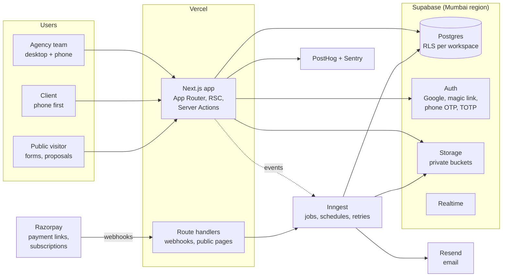

# Architecture

**Goal:** a multi-tenant SaaS that one person can run, that stays fast on a mid-range Android phone, keeps every agency's data apart, and grows from the first workspace to tens of thousands without a rewrite.

Decisions and their reasons are logged in `../00-plan/decisions.md`. Versions: use the current stable release of each tool at setup time and pin it in `package.json`; record the versions in `../00-plan/decisions.md`.

## System overview



## Repository layout (pnpm workspaces + Turborepo)

```
apps/
  web/                    Next.js app: marketing pages, app, client portal, public pages
    app/
      (marketing)/        landing, pricing, legal pages (R0: minimal)
      (auth)/             sign-in, sign-up, magic link, OTP, invite accept
      (app)/[workspace]/  the agency app: today, dashboard, leads, clients, projects, tasks, finance, team, settings
      (portal)/p/[workspace]/  the client portal (own layout, phone-first)
      (public)/           proposal view and sign, enquiry form, invoice pay page
      api/                route handlers: webhooks (razorpay), inngest, health
    prototype/            G1/G2 clickable prototype routes (feature-flagged; removed after G3)
packages/
  ui/                     shadcn components restyled + Agency OS patterns; Storybook
  tokens/                 tokens.json, globals.css generator, contrast check
  core/                   pure TypeScript domain logic: money, tax (GST), numbering, dates, permissions, words
  db/                     Drizzle schema, migrations, RLS policies (SQL), seed and sample data
  emails/                 React Email templates
  jobs/                   Inngest functions (reminders, PDFs, webhooks, exchange rates, exports)
  i18n/                   message catalogues (en-IN, en-US, en-GB; hi, te later)
  config/                 shared tsconfig, eslint, prettier
docs/                     this pack
design/                   the design system reference (read-only)
tokens/                   copied into packages/tokens at M1
```

Rules: `core` has no framework imports and 100% unit-test coverage on tax and money. `ui` never imports from `db`. Apps import packages; packages never import apps.

## Multi-tenancy

- **Shared database, shared schema.** Every tenant table has `workspace_id uuid not null` with an index that starts with it.
- **Row-level security on every table** (enabled and forced). Policies call two `security definer` SQL functions:
  - `is_member(workspace_id)`: the signed-in user has an active membership.
  - `has_permission(workspace_id, permission)`: the member's role grants the permission (the matrix in `../02-product/information-architecture.md` is stored as data, not code).
- **Client portal users** are auth users linked to `client_contacts`. Portal policies let them read only their client's projects, phases, gates, files, messages and invoices, and write only approvals, messages and payments.
- **Public links** (proposal view, invoice pay page, enquiry form) use unguessable tokens (128-bit) handled in route handlers with the service role, and expose only the fields the page needs.
- **Defence in depth:** server actions also check `can(user, action, resource)` from `packages/core/permissions` before writing. RLS is the guarantee; the app check gives friendly errors.
- **Service role** is used only in jobs and webhooks, always with an explicit `workspace_id` filter, and never reaches the browser.

### How queries run under RLS

Server code connects through the Supabase pooler with Drizzle. Each request runs inside a transaction that sets the user's JWT claims (`set_config('request.jwt.claims', …, true)` and `set local role authenticated`), so Postgres applies RLS exactly as it would for Supabase's own client. A helper `withUser(session, tx => …)` in `packages/db` is the only way app code gets a database handle. Tests prove a member of workspace A cannot read or write workspace B (`testing.md`).

## Data rules

- **Money:** integers in minor units (`bigint`) plus an ISO 4217 currency code. Never floats. Exchange rates are `numeric(18,8)`. Quantities are `numeric(12,3)`. Tax rates are basis points (1800 = 18%).
- **IDs:** UUID v7 (time-ordered) generated in the app. Human-facing numbers (invoice numbers) are separate, allocated in a transaction from `invoice_sequences`.
- **Time:** `timestamptz` in UTC; display in the workspace or viewer time zone. Dates without time (due dates) are `date`.
- **Soft delete** (`deleted_at`) for anything a user can delete, so Undo and restore work; a nightly job purges after 30 days (except invoices, which are never hard-deleted; they are cancelled).
- **Audit:** `created_at`, `updated_at`, `created_by` everywhere; important actions also go to `audit_log`.
- **Search:** Postgres full-text plus `pg_trgm` on names, companies, emails and invoice numbers, one `search_index` view per workspace. Meets the command palette target (under 300ms for 10,000 records).

## Rendering and performance

- React Server Components by default; client components only for interaction (board drag and drop, forms, command palette).
- Data mutations through Server Actions with zod validation, returning typed results (`{ ok, data } | { ok: false, error }`).
- Lists paginate on the server (cursor based). Tables load the first page in the RSC payload.
- Optimistic updates for drag and drop and quick edits, with rollback and a toast on failure.
- Budgets (CI-checked with Lighthouse CI on the portal home and the leads page): LCP under 2.5s on a mid-range phone over 4G, JavaScript under 170 KB gzipped for the portal home, CLS under 0.1.
- Images through `next/image`; fonts self-hosted with `font-display: swap`.

## Background work (Inngest)

Anything slow, retryable or scheduled: PDF generation, emails, invoice reminders, payment webhooks processing, CSV import and export, exchange-rate fetch, sample-data load and removal, trash purge. Every function is idempotent (keyed on an event ID) and logs to Sentry on final failure.

## Files

Supabase Storage, private buckets per purpose (`files`, `pdfs`, `logos`), object paths `workspace_id/…`, storage RLS mirroring table RLS, signed URLs that expire in 10 minutes, uploads direct from the browser with signed upload URLs, 25 MB limit per file in R1, type allow-list.

## Scaling path

| Stage | What changes |
| --- | --- |
| Launch (up to ~1,000 workspaces) | One Supabase project (Pro), Vercel Pro, Inngest free or Pro. Indexes on every `(workspace_id, …)`. |
| Growth (~10,000 workspaces) | Larger Postgres compute; read replica for dashboards and exports; partition `audit_log` and `activities` by month; cache dashboard aggregates in materialised views refreshed by jobs; rate limits on public endpoints (Upstash). |
| Large | Move heavy reporting to a warehouse (PostHog data warehouse or BigQuery export); split the client portal to its own app if its traffic pattern differs; consider regional projects for EU data residency if customers require it. |

Nothing in R0 or R1 should block these steps: keep queries tenant-scoped, avoid cross-workspace joins, and keep jobs idempotent.

## Observability

Sentry (errors and performance, with source maps, PII scrubbing), PostHog (product analytics, feature flags, session replay with inputs masked), Vercel logs, Supabase logs and advisors. A `/api/health` route checks the database and storage. Alerts: error spikes, failed webhooks, failed jobs, slow queries.
