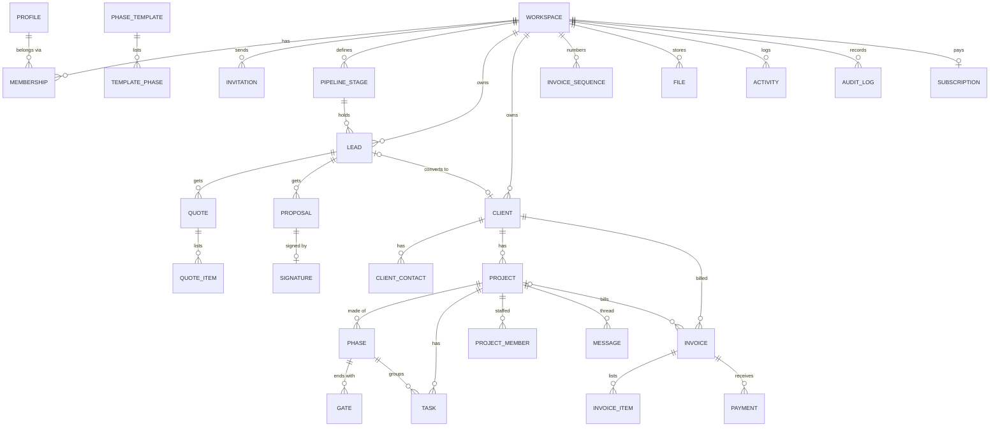

# Data model (R0 and R1)

Postgres via Drizzle (`packages/db/schema`). Conventions from `architecture.md`: `snake_case`; `id uuid` (v7) primary keys; `workspace_id` on every tenant table; `created_at`, `updated_at`, `created_by`; `deleted_at` for soft delete; money as `bigint` minor units plus `currency char(3)`; `is_example boolean default false` on every table that sample data fills (leads, clients, contacts, projects, phases, gates, tasks, invoices, payments, activities). Later releases add tables; they never change the meaning of these.

## Entity relationships



## Tables

### Accounts and workspaces (R0)

| Table | Key columns | Notes |
| --- | --- | --- |
| `profiles` | `id` (= `auth.users.id`), `full_name`, `phone`, `avatar_path`, `locale`, `time_zone` | One per person |
| `workspaces` | `name`, `slug` (unique), `country` (ISO 3166), `base_currency`, `locale`, `time_zone`, `logo_path`, `brand_color`, `gstin`, `legal_name`, `state_code`, `address jsonb`, `lut_arn`, `lut_valid_from`, `lut_valid_to`, `invoice_prefix`, `plan`, `onboarding jsonb` | Country IN sets INR, en-IN, Asia/Kolkata |
| `memberships` | `workspace_id`, `user_id`, `role` (owner, admin, project_lead, member, finance, hr), `status` (active, suspended) | Unique `(workspace_id, user_id)` |
| `role_permissions` | `role`, `permission` | Seeded from the IA matrix; used by `has_permission()` |
| `invitations` | `workspace_id`, `email` or `phone`, `role`, `token_hash`, `expires_at`, `accepted_at`, `revoked_at` | 7-day expiry |
| `subscriptions` | `workspace_id`, `plan`, `status`, `provider` (razorpay), `provider_subscription_id`, `current_period_end` | Agency OS's own billing |
| `audit_log` | `workspace_id`, `actor_id`, `action`, `subject_type`, `subject_id`, `ip`, `user_agent`, `changes jsonb`, `created_at` | Append-only (no update or delete policy) |
| `notifications`, `notification_preferences` | `user_id`, `workspace_id`, `kind`, `payload`, `read_at`; per-category channel settings | In-app list and email |

### Sell (R1)

| Table | Key columns | Notes |
| --- | --- | --- |
| `pipeline_stages` | `workspace_id`, `name`, `position`, `kind` (open, won, lost) | Defaults: New, Contacted, Proposal, Won, Lost |
| `leads` | `stage_id`, `position`, `name`, `company`, `email`, `phone`, `source`, `value_minor`, `currency`, `service`, `notes`, `owner_id`, `next_follow_up_at`, `lost_reason`, `converted_client_id`, `is_example` | `is_example` marks sample data for one-click removal |
| `activities` | `subject_type`, `subject_id`, `kind` (note, call, email, stage_change, proposal_viewed, …), `body`, `actor_id`, `meta jsonb` | Feeds every ActivityFeed |
| `quotes`, `quote_items` | quote: `lead_id` or `client_id`, `number`, `currency`, `discount_minor`, `tax_mode`, totals, `valid_until`, `status`; item: `description`, `sac_code`, `quantity`, `rate_minor`, `tax_rate_bp`, `amount_minor`, `position` | Totals computed by `core/tax`, stored for history |
| `proposals` | `lead_id`, `quote_id`, `template_id`, `blocks jsonb`, `status` (draft, sent, viewed, signed, declined, expired), `public_token_hash`, `sent_at`, `first_viewed_at`, `view_count`, `expires_at` | Blocks are versioned with the record |
| `signatures` | `proposal_id`, `signer_name`, `signer_email`, `signer_phone`, `verified_via` (email_otp, phone_otp), `signature_image_path`, `ip`, `user_agent`, `signed_at`, `document_sha256`, `audit_pdf_path` | Evidence for the audit trail |
| `enquiry_forms` | `workspace_id`, `public_token`, `fields jsonb`, `is_active` | Hosted form creating leads (source Website) |

### Clients and projects (R1)

| Table | Key columns | Notes |
| --- | --- | --- |
| `clients` | `name`, `legal_name`, `gstin`, `state_code`, `country`, `currency`, `time_zone`, `billing_address jsonb`, `preferred_channel`, `notes`, `from_lead_id` | `state_code` drives GST place of supply |
| `client_contacts` | `client_id`, `name`, `email`, `phone`, `role`, `user_id` (portal login, nullable), `is_primary` | |
| `phase_templates`, `template_phases`, `template_checklist_items` | `workspace_id` (null = system template), `name`; phases with `has_gate`, `default_approver` | Seeded: the seven phases |
| `projects` | `client_id`, `name`, `type` (one_off, retainer), `budget_minor`, `currency`, `start_on`, `due_on`, `lead_member_id`, `template_id`, `status`, `health` | |
| `project_members` | `project_id`, `user_id`, `role_on_project` | |
| `phases` | `project_id`, `name`, `position`, `status` (not_started, in_progress, done, skipped), `starts_on`, `ends_on` | |
| `gates` | `phase_id`, `title`, `description`, `approver_type` (client, internal), `approver_contact_id` / `approver_user_id`, `status` (not_started, waiting, approved, changes_requested), `requested_at`, `decided_at`, `decided_by`, `decision_comment` | Every decision also writes `activities` and `audit_log` |
| `tasks` | `project_id`, `phase_id`, `parent_task_id`, `title`, `description`, `assignee_id`, `due_on`, `priority`, `status`, `position` | Board order by `position` (fractional index) |
| `comments` | `subject_type`, `subject_id`, `author_id` or `author_contact_id`, `body`, `mentions` | |
| `messages` | `project_id`, `author_id` or `author_contact_id`, `body`, `file_ids` | Portal thread per project |
| `files` | `storage_path`, `name`, `mime`, `size_bytes`, `subject_type`, `subject_id`, `visibility` (internal, client) | |
| `daily_updates` | `user_id`, `project_id`, `done`, `next`, `blockers`, `for_date` | |

### Money (R1)

| Table | Key columns | Notes |
| --- | --- | --- |
| `invoice_sequences` | `workspace_id`, `financial_year` ('26-27'), `prefix`, `next_number` | Row-locked (`select … for update`) when issuing; numbers are consecutive per FY and at most 16 characters |
| `invoices` | `client_id`, `project_id`, `quote_id`, `number`, `financial_year`, `type` (tax_invoice, bill_of_supply, export_lut, proforma), `status` (draft, issued, partially_paid, paid, overdue, cancelled), `currency`, `exchange_rate`, `base_currency`, `supplier_state_code`, `place_of_supply_code`, `issue_on`, `due_on`, `subtotal_minor`, `cgst_minor`, `sgst_minor`, `igst_minor`, `round_off_minor`, `total_minor`, `amount_paid_minor`, `lut_arn`, `notes`, `terms`, `pdf_path`, `public_token_hash` | A draft has no number; issuing assigns one. Issued invoices are never edited or deleted, only cancelled (credit notes come later). |
| `invoice_items` | `description`, `sac_code`, `quantity`, `rate_minor`, `discount_minor`, `taxable_minor`, `tax_rate_bp`, `cgst_minor`, `sgst_minor`, `igst_minor`, `amount_minor`, `position` | |
| `payments` | `invoice_id`, `amount_minor`, `currency`, `method` (upi, card, netbanking, bank_transfer, wise, paypal, cash, other), `provider`, `provider_payment_id` (unique), `received_on`, `fira_file_id`, `notes` | |
| `payment_links` | `invoice_id`, `provider_link_id`, `short_url`, `status`, `expires_at` | |
| `reminders` | `invoice_id`, `kind` (before_due, on_due, after_due), `scheduled_for`, `sent_at`, `channel` | |
| `exchange_rates` | `on_date`, `base`, `quote`, `rate`, `source` | Daily fetch; the user can override the rate on an invoice |
| `webhook_events` | `provider`, `event_id` (unique), `type`, `payload jsonb`, `received_at`, `processed_at`, `error` | Idempotency for every webhook |

## Tax logic (packages/core/tax)

Pure functions, unit-tested for every case below. A chartered accountant reviews the outputs and the invoice template before launch (blocking).

1. **Supplier not GST-registered** → bill of supply, no tax lines.
2. **Client outside India** → export of services:
   - with a valid LUT for the invoice date → IGST 0%, and the invoice states "Supply meant for export under LUT (ARN …) without payment of IGST" (exact wording confirmed by the CA);
   - without a LUT → IGST at the item rate.
3. **Client in India** → place of supply = client's state (from the GSTIN's first two digits when present, else the billing address):
   - same state as the supplier → CGST + SGST, each half the item rate;
   - different state → IGST at the item rate.
4. Tax is computed per line on the taxable value, each head rounded half-up to the paisa (minor unit). An optional round-off line brings the total to the nearest rupee.
5. GSTIN validation: 15 characters, pattern `^[0-9]{2}[A-Z]{5}[0-9]{4}[A-Z][1-9A-Z]Z[0-9A-Z]$` and the checksum digit; the first two digits must be a valid state code.
6. Invoice numbers: consecutive per financial year (April to March), at most 16 characters, letters, digits, `/` and `-` only.
7. Default item rate 18% (most design and development services); the rate and SAC code are editable per item.
8. Amounts in words in the Indian system for INR (lakh, crore), and in the international system for other currencies.
9. E-invoicing (IRN and QR) applies only above ₹5 crore turnover; not in R1, but keep the fields needed (supplier and buyer GSTIN, HSN/SAC, place of supply) so it can be added.

## Row-level security

Every table: `enable row level security; force row level security;`. Policy pattern (written in SQL migrations in `packages/db/policies/`):

```sql
create policy leads_select on leads for select
  using (is_member(workspace_id) and has_permission(workspace_id, 'leads.read'));
create policy leads_write on leads for all
  using (is_member(workspace_id) and has_permission(workspace_id, 'leads.write'))
  with check (is_member(workspace_id) and has_permission(workspace_id, 'leads.write'));
```

Portal policies use `is_client_contact_for(client_id)`. `audit_log` has insert-only policies. Storage objects use the same functions on the first path segment (`workspace_id`).

## Sample data

`packages/db/seed/sample.ts` creates one example client, two leads, one project in the Design phase with a waiting gate, three tasks and one paid and one pending invoice, all with `is_example = true`, the names used in the design reference (Kite & Co, Northwind, Lumen Foods), and "Example" shown on every record. Removing sample data deletes only `is_example` rows.
